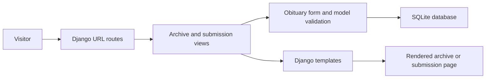
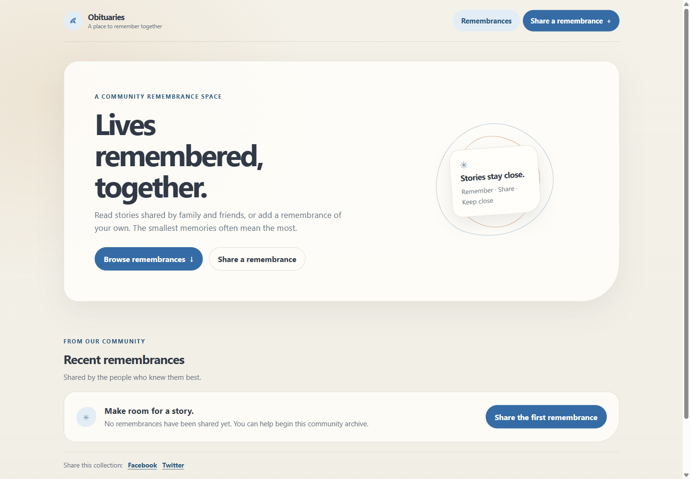
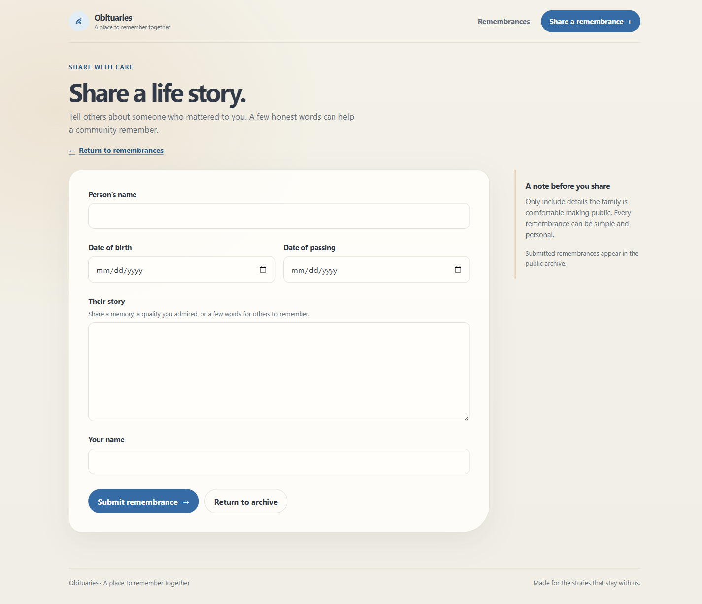

# 🕯️ Orbituary-Platform: A Community Memorial Archive

**Orbituary-Platform** is a self-contained Django archive I revisited from my university-era work. I wanted to bridge the gap between a read-only obituary list and a community flow for sharing and browsing remembrances, using a production-grade form and data flow while keeping the archive and submission paths easy to run locally.

---

## 🎯 Project Goal

Orbituary gives family and friends two straightforward ways to take part: browse remembrance stories and submit one of their own. I kept the original five submission fields and made the archive, form, validation, and local database work together as one small Django application.

---

## 🧬 System Architecture



1. **Routes and views** — Django routes visitors to the remembrance archive or submission form.
2. **Validation** — A model form accepts the person's name, birth date, passing date, story, and author's name. The model rejects a passing date earlier than the birth date.
3. **Storage** — SQLite stores submitted records, and each remembrance receives a unique slug, including when names repeat.
4. **Presentation** — Django templates render the archive and form; local CSS and JavaScript provide the interface and client-side date guidance.

---

## 🛠️ Technical Stack

| **Layer** | **Tool** | **Version** | **Purpose** |
| --- | --- | --- | --- |
| **Application** | Python | 3.10+ | Django project and server-side behavior |
| **Web framework** | Django | 5.2.18 | Routing, forms, validation, templates, and admin |
| **Database** | SQLite | Python standard library | Local storage for remembrance records |
| **Interface** | HTML and CSS | HTML Living Standard / CSS3 | Archive, submission form, and responsive styling |
| **Client-side guidance** | Vanilla JavaScript | Browser-native | Date-entry feedback on the submission form |

---

## 📊 Performance & Results

- The rebuild preserves **2 user flows** and the original **5 submission fields**.
- Django migrations applied successfully to a separate scratch database created for this screenshot pass.
- The archive and submission pages both returned **HTTP 200** during the local browser review.
- Manual review covered an empty archive, valid and invalid date ordering, duplicate names, and **320px, 375px, and desktop** layouts.
- The screenshots were captured against an empty isolated database and contain no memorial entries.

---

## 📸 Screenshots

<p align="center">
  
  
</p>
<p align="center"><sub>Remembrance archive · Share a life story</sub></p>

---

## 🕊️ Memorial Record

| **Field** | **Purpose and behavior** |
| --- | --- |
| Person's name | Identifies the person remembered |
| Date of birth | Captured as a date |
| Date of passing | Captured as a date; cannot be earlier than the birth date |
| Their story | Stores the remembrance text |
| Your name | Identifies the person sharing the remembrance |
| Slug | Generated from the person's name and made unique for archive links |

---

## 🧠 Key Design Decisions

- **Preserve the original two flows:** The archive remains the home page, and the submission page keeps the same five fields.
- **Give each remembrance a stable URL:** Slugs are generated from names and receive a numeric suffix when a name repeats.
- **Use a separate local database:** `ORBITUARY_DB_PATH` lets me run migrations and the demo without writing to the bundled `db.sqlite3`.
- **Keep the current scope local:** This rebuild is a project demonstration, not a hosted memorial service. Use fictional or explicitly approved data while running it locally.

---

## 📂 Project Structure

```text
Orbituary-Platform/
├── manage.py
├── requirements.txt
├── .env.example
├── obituary_platform/
│   ├── settings.py
│   ├── urls.py
│   ├── asgi.py
│   └── wsgi.py
├── obituaries/
│   ├── admin.py
│   ├── forms.py
│   ├── models.py
│   ├── urls.py
│   ├── views.py
│   ├── migrations/
│   ├── static/
│   │   ├── css/styles.css
│   │   ├── images/orbituary-mark.svg
│   │   └── js/validate.js
│   └── templates/obituaries/
│       ├── base.html
│       ├── obituary_form.html
│       ├── view_obituaries.html
│       └── partials/field.html
└── docs/screenshots/             # Browser captures used in this README
```

---

## ⚙️ Installation & Setup

1. Create and activate an environment, then install the pinned dependency:

   ```shell
   uv venv
   ```

   In Windows PowerShell:

   ```powershell
   .\.venv\Scripts\Activate.ps1
   ```

   In macOS or Linux:

   ```shell
   source .venv/bin/activate
   ```

   Then install the project requirements:

   ```shell
   uv pip install -r requirements.txt
   ```

2. Point Django at a separate local database and run migrations.

   Windows PowerShell:

   ```powershell
   $env:DJANGO_DEBUG = "true"
   $env:ORBITUARY_DB_PATH = ".local\obituaries.sqlite3"
   New-Item -ItemType Directory -Force .local | Out-Null
   python manage.py migrate
   ```

   macOS or Linux:

   ```shell
   export DJANGO_DEBUG=true
   export ORBITUARY_DB_PATH=.local/obituaries.sqlite3
   mkdir -p .local
   python manage.py migrate
   ```

3. Start Django:

   ```shell
   python manage.py runserver
   ```

   | **Page** | **Local URL** |
   | --- | --- |
   | Remembrance archive | `http://127.0.0.1:8000/` |
   | Share a remembrance | `http://127.0.0.1:8000/submit/` |
   | Django admin | `http://127.0.0.1:8000/admin/` |

The `.env.example` file lists supported settings for reference; Django does not load `.env` files by itself. Set the environment variables in your shell or hosting platform.

---

## 🔐 Local Data and Configuration

The project defaults to `db.sqlite3` to preserve compatibility with the earlier checkout. For a fresh local run, set `ORBITUARY_DB_PATH` to a new file as shown above. Keep `DJANGO_SECRET_KEY` private, set `DJANGO_DEBUG=false` outside local development, and configure `DJANGO_ALLOWED_HOSTS` for the deployment hostnames before any deployment.

---

## 🎓 Skills Demonstrated

- **Django application structure:** Connecting routes, views, forms, models, templates, and migrations.
- **Server-side validation:** Enforcing date ordering and unique archive slugs.
- **Database configuration:** Isolating local SQLite state through environment-based settings.
- **Accessible form design:** Pairing visible labels, field-level errors, and client-side date guidance.
- **Responsive interface work:** Reviewing the archive and submission flow across phone and desktop widths.
